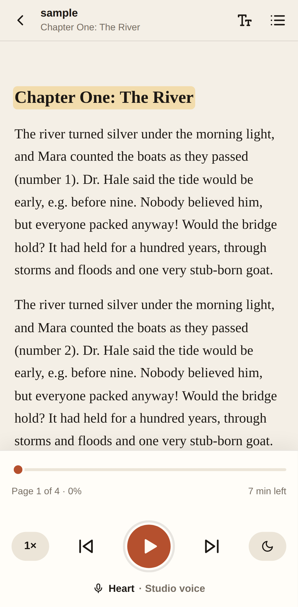
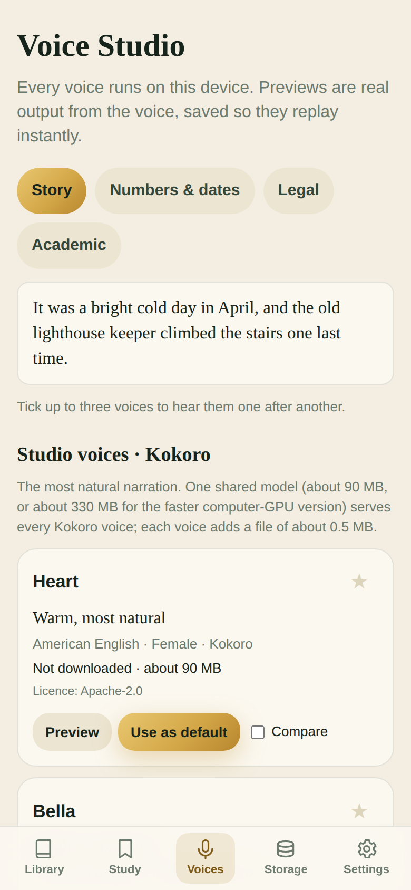
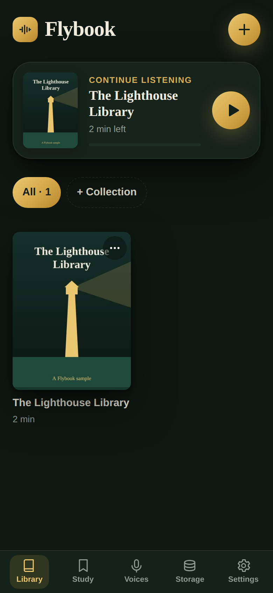

# Flybook

Listen to PDFs as audiobooks and study them — in the browser, on your device. No account, no server.

<p>
  
  
  
  
</p>

Live: <https://akatetron.github.io/flybook/>

## What it does

- **Library.** Import a PDF (read on the device with pdf.js) or try the bundled sample story. Group documents into
  collections (a course, a matter, a project). Continue where you left off.
- **Reader.** Listen view and Read view with the spoken sentence highlighted; chapters (PDF outline, detected headings
  or page ranges); speed; sleep timer; lock-screen and headphone controls (Media Session); keyboard shortcuts.
  Reopening a document resumes at the saved sentence.
- **Voices** (Voice Studio). Real previews from each voice on sample passages (story, numbers and dates, legal,
  academic), saved so they replay instantly; compare up to three in turn; favourites; a default voice; each document
  remembers its own voice; each chapter can have its own voice.
  - **Kokoro** (studio): most natural. One shared model — ~92 MB (8-bit, CPU) or ~326 MB (full precision, used on
    computers with WebGPU) — serves all Kokoro voices; each voice adds a ~0.5 MB style file.
  - **Piper** (lightweight): ~60 MB per voice, faster on phone CPUs. Licences vary per voice (shown in the app).
  - **Instant**: the browser's built-in speech. Starts immediately; can't be prepared ahead; Flybook can't verify it
    works offline.
- **Preparation.** Sentences are generated ahead of playback and saved (IndexedDB), so prepared stretches play without
  buffering and are never generated twice. Queue chapters to prepare ahead; cancel any time.
- **Study.** Tap a sentence in Read view (tap another to extend) to highlight in four colours, add a note, bookmark,
  or correct the spoken text for that document (the extracted text is kept and can be restored). The Study screen
  searches and filters everything (document, type, colour, date), jumps back to the passage, and exports Markdown,
  JSON or CSV with document titles and page numbers.
- **Research/legal reading options.** Don't read numeric or author–year citations aloud; skip reference sections when
  playing through. Both change only what's spoken.
- **Audio export.** Save a fully prepared chapter as one WAV file (joined on the device from the saved sentences).
- **Offline storage** screen: browser usage/quota estimate, persistent-storage status (and a request button), voice
  models with their real state, prepared audio per document and voice, documents — each removable separately.

## Storage and offline behaviour

| What | Where | Removed by |
| --- | --- | --- |
| App shell | Service worker cache `flybook-app-v1` | App updates; clearing site data |
| Voice models | Cache Storage: `transformers-cache` + `kokoro-voices` (Kokoro), `flybook-piper-v1` (Piper) | Storage screen; clearing site data; browser eviction |
| Documents, positions, notes, original PDFs | IndexedDB `flybook` (v2) | Library/Storage screens; clearing site data |
| Prepared audio and voice previews | IndexedDB `flybook-audio-2` | Storage screen; automatic trimming above ~600 MB; clearing site data |

**Model readiness is decided by the files, not a flag.** At startup every model's files are checked in Cache Storage
(`src/tts/registry.ts`, `src/tts/modelStore.ts`): present, non-empty, and matching the size the server sent. A model
is *ready*, *not downloaded*, *missing files*, *damaged* or *storage unavailable*. Old localStorage "downloaded" flags
are cleared when they disagree. *Repair* deletes only damaged files so the next use re-downloads just those. Large
model files are not read back to measure them (that would load 90–330 MB into memory on a phone); Cache Storage only
stores complete responses, so their recorded size is trusted.

Downloads and caching of the model files themselves are handled by the engines (transformers.js for Kokoro, our worker
for Piper). They download whole files: an interrupted download is not cached and starts that file again; files already
stored are kept.

What to expect: data normally survives refreshing and closing the page. It is **not** permanent — clearing site data
removes it, browsers may evict it under storage pressure (less likely once persistent storage is granted), and it is
not shared between browsers or devices. After one online visit, the app, your documents and prepared audio open
offline (tested in Chromium); generating *new* audio offline needs the voice model to be stored already.

## Privacy

Documents, extracted text, notes and audio stay in the browser. Network requests: the app (GitHub Pages), typefaces
(Google Fonts), and — only when a voice is used — its model files from huggingface.co. No analytics.

## Develop

```bash
npm install
npm run dev          # http://localhost:5173
npm test             # unit tests (Node test runner)
npm run typecheck
npm run build        # static site in dist/
npm run e2e          # browser tests (Playwright, Chromium) against dist/ served under /flybook/
```

Browser tests need a Playwright Chromium (`npx playwright install chromium`, or set `PW_CHROMIUM` to an existing
Chromium binary). They cover: first visit and sample story, highlights/notes/bookmarks surviving reload, Study search,
Markdown export, jumping to a passage, resuming position, theme persistence, a damaged PDF, no horizontal overflow on
phone and desktop layouts, and opening the app and a saved book offline. They can't download voice models (that would
fetch hundreds of MB from Hugging Face), so model download, generation and model reuse after refresh are covered by
unit tests of the registry plus manual testing.

## Deploy

`.github/workflows/deploy.yml` runs unit tests, the build and the browser tests, then deploys `dist/` to GitHub Pages
on every push to `main`. The build uses relative paths, so it works under `/flybook/` or any other path. GitHub Pages
can't set headers, so the service worker adds the cross-origin isolation headers multi-threaded voice generation
needs, and reloads once on the first visit. Other hosts: `public/_headers` and `vercel.json` set them directly.

## Code map

| Piece | File |
| --- | --- |
| PDF → lines, text-quality classification | `src/lib/pdf.ts`, `src/lib/pdfQuality.ts` |
| Paragraphs, sentences, chapters (shared with the mobile app) | `shared/text.ts` |
| Citation/reference narration filters | `shared/narration.ts` |
| Model registry and file verification | `src/tts/registry.ts`, `src/tts/modelStore.ts` |
| Engines (Kokoro, Piper) in Web Workers | `src/tts/kokoro*.ts`, `src/tts/piper*.ts`, `src/tts/engines.ts` |
| Playback and preparation | `src/tts/narrator.ts` |
| Library DB (v2: books, contents, annotations, collections, files) | `src/lib/db.ts` |
| Prepared audio | `src/lib/audioStore.ts` |
| Annotations: anchors, search, export | `src/lib/annotations.ts` |
| Chapter WAV export | `src/lib/wav.ts` |
| Screens | `src/components/` |
| Native iOS/Android app (separate) | `mobile/` |

## Licences and credits

Kokoro-82M (Apache-2.0) via `kokoro-js` (Apache-2.0); its pronunciation step uses the `phonemizer` package, which
bundles espeak-ng (GPL-3.0). Piper engine (MIT) with the phonemizer build from `@diffusionstudio/piper-wasm`, which
includes espeak-ng (GPL-3.0); Piper **voices** have per-voice licences set by their training data — `en_US-lessac` and
`en_US-ryan` are non-commercial, others are listed as unverified in the app. ONNX Runtime Web (MIT), pdf.js
(Apache-2.0), idb (ISC), React (MIT).

## Known limitations

- **Scanned PDFs**: no OCR yet. Image-only PDFs are refused with an explanation; partly scanned ones import with a
  warning.
- **No original-page view yet**: highlighting follows the extracted text (Read view), not the rendered PDF page. The
  original PDF is now stored at import to make that possible.
- **No EPUB support yet.**
- **Audio export** is WAV only (large files: about 2.9 MB per minute at 24 kHz). No MP3/M4B.
- Narration options apply to sentences prepared after the change; delete prepared audio to redo older ones.
- Kokoro on phones can be slower than real time; preparation ahead hides this only if started early enough.
- iOS may suspend generation while the screen is locked; already-prepared audio keeps playing.
- Voice benchmark: see `docs/voice-benchmark.md` (protocol written; device measurements not yet recorded).
