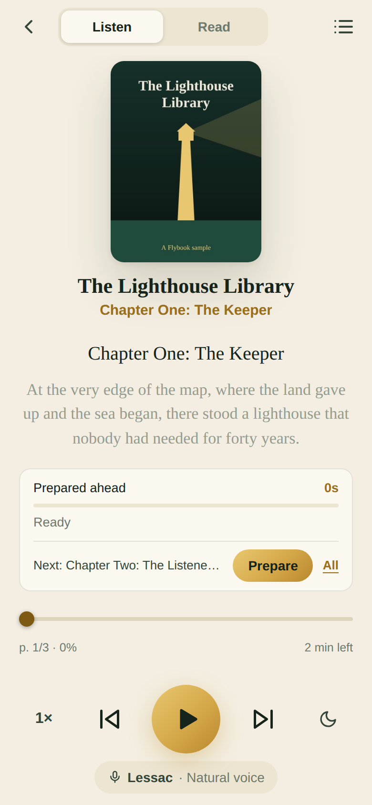
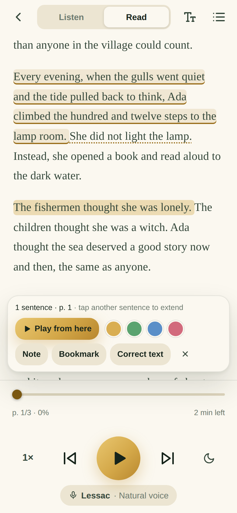
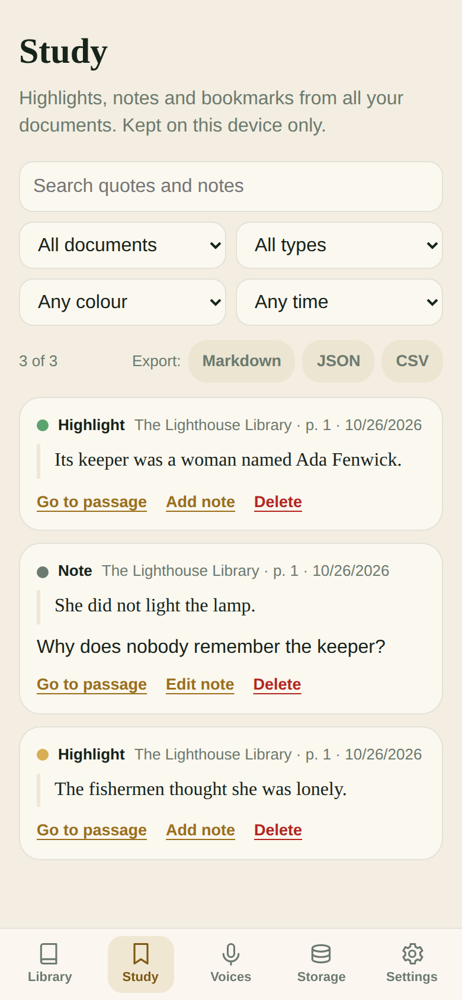
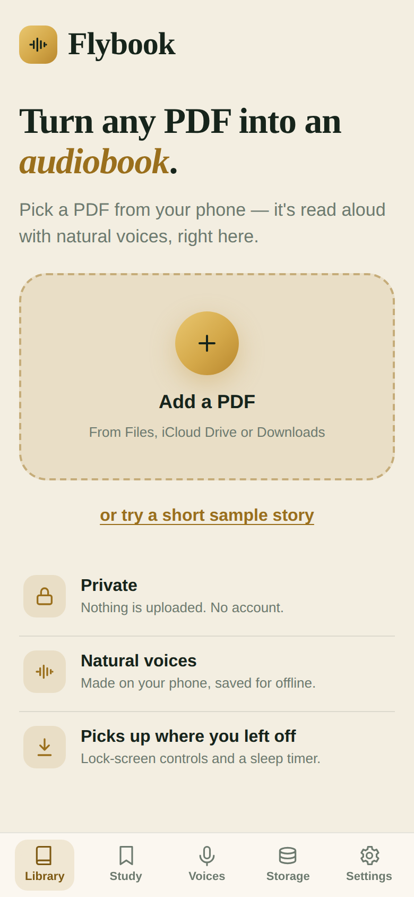
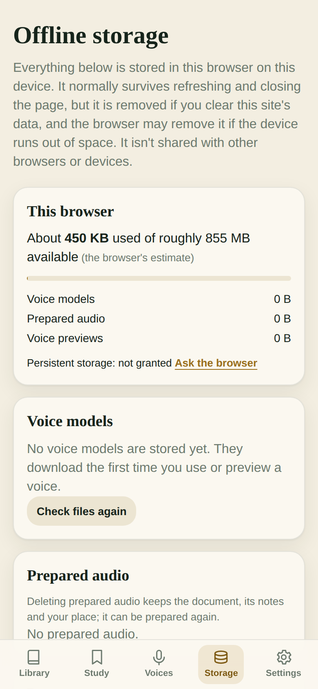

<div align="center">


# Flybook

**Listen to any PDF as an audiobook — and study it — entirely on your device.**

Natural neural voices · highlights & notes · works offline · no account · nothing uploaded

[**Open Flybook →**](https://akatetron.github.io/flybook/)


<br>

&nbsp;
&nbsp;
&nbsp;


</div>

---

## Why Flybook

Most "PDF to speech" tools upload your document to a server. Flybook doesn't have one. The PDF is read, narrated
and annotated **inside your browser**, so private papers, contracts and books never leave your device — and once a
chapter is prepared, it plays offline.

## Features

<table>
<tr>
<td width="50%" valign="top">

### 🎧 Listen
- Neural **studio voices** (Kokoro) and **lightweight voices** (Piper) generated on your device, plus your browser's instant voices
- Prepares sentences ahead so playback doesn't stall; saved audio is never generated twice
- Queue whole chapters to prepare, each with its own voice
- Speed, sleep timer, lock-screen & headphone controls, keyboard shortcuts
- Picks up exactly where you left off

</td>
<td width="50%" valign="top">

### 📖 Read & study
- Follow-along text with the spoken sentence highlighted
- Tap sentences to **highlight** (4 colours), **note**, **bookmark** or **correct the spoken text**
- **Study** screen: search and filter everything, jump back to the passage
- Export notes to **Markdown, JSON or CSV** with page references
- Group documents into **collections** (a course, a case, a project)

</td>
</tr>
<tr>
<td valign="top">

### 🗣 Voice Studio
- Real previews on story, numbers, legal and academic passages
- Compare voices back to back, star favourites, set a default
- Each document remembers its voice
- Licence and download size shown for every voice

</td>
<td valign="top">

### 🔒 Private & offline
- No account, no server, no analytics
- **Storage** screen shows exactly what's stored, verified against the real files
- Remove voices, prepared audio or documents independently
- Export a prepared chapter as a **WAV** file

</td>
</tr>
</table>

**For research and legal reading:** optionally skip citations like `[12]` or `(Smith, 2020)` and pass over reference
lists. Web addresses are read as "link to example.com" instead of letter by letter. These change only what's
spoken — your text and notes keep everything.

<div align="center">
&nbsp;
&nbsp;

</div>

## Try it in 30 seconds

1. Open **[akatetron.github.io/flybook](https://akatetron.github.io/flybook/)** on your phone or computer.
2. Tap **“or try a short sample story”** — or choose any text-based PDF.
3. Press play. The first studio voice downloads once (about 92 MB); after that it's on your device.

> **Tip (iPhone):** Share → *Add to Home Screen*. Safari may clear a website's data after a week without visits;
> a home-screen app keeps it.

## Voices

| | Engine | Download | Best for |
| --- | --- | --- | --- |
| **Studio** — Heart, Bella, Nicole, Emma, Michael, Fenrir, Puck, George, Fable | Kokoro-82M | ~92 MB once, shared by all (≈326 MB GPU version on computers) | The most natural narration |
| **Lightweight** — Amy, Kristin, Cori, Alba, Joe, Alan, Northern, Lessac, Ryan | Piper | ~60 MB per voice | Older phones |
| **Instant** | Your browser | none | Immediate playback; can't be prepared ahead |

### Measured

Real run in headless Chromium on a 3-core cloud CPU (no GPU), with a 2-page, 77-sentence README PDF:

| Step | Result |
| --- | --- |
| PDF import (text, sentences, chapters) | 1.1 s |
| First audio after pressing play, **including** the voice download | 33 s |
| Kokoro generation speed on that CPU | ≈ 0.5× real time — the app detects this and suggests pausing to build a buffer |

Computers with WebGPU, and recent phones with a Piper voice, are typically much faster. Device results are collected
in [`docs/voice-benchmark.md`](docs/voice-benchmark.md).

## How storage works

Everything lives in your browser on this device:

| What | Where |
| --- | --- |
| Documents, reading positions, notes, original PDFs | IndexedDB `flybook` (versioned; upgrades keep your data) |
| Prepared audio & voice previews | IndexedDB `flybook-audio-2` (oldest trimmed above ~600 MB) |
| Voice models | Cache Storage — checked file by file at startup |
| The app itself | Service worker cache, for offline use |

A voice counts as installed only if its files are actually present and intact — Flybook checks the files, not a
remembered flag, and **Repair** re-downloads only damaged ones. Data normally survives refreshes and closing the
tab, but it isn't permanent: clearing site data removes it, browsers can evict it when space is short, and it isn't
shared between browsers or devices. The Storage screen can ask the browser for persistent storage.

**Network use:** the app (GitHub Pages), its typefaces (Google Fonts), and — only when you use a voice — that
voice's files from huggingface.co. Your documents, notes and audio are never sent anywhere.

## Run it yourself

```bash
npm install
npm run dev          # http://localhost:5173
npm test             # 44 unit tests
npm run typecheck
npm run build        # static site in dist/
npm run e2e          # 18 Playwright browser tests (desktop + phone) against dist/ under /flybook/
```

Every push to `main` runs the unit tests, the build and the browser tests, then deploys to GitHub Pages
([`deploy.yml`](.github/workflows/deploy.yml)). Paths are relative, so `dist/` works under any folder on any static
host. GitHub Pages can't set headers, so the service worker adds the cross-origin isolation headers needed for
multi-threaded voices; `public/_headers` and `vercel.json` do it on Netlify, Cloudflare Pages and Vercel.

<details>
<summary><b>Code map</b></summary>

| Piece | File |
| --- | --- |
| PDF → lines, text-quality check (text / sparse / partly scanned / image-only) | `src/lib/pdf.ts`, `src/lib/pdfQuality.ts` |
| Paragraphs, sentences, chapters, spoken text | `shared/text.ts` |
| Citation and reference filters | `shared/narration.ts` |
| Voice model registry and file verification | `src/tts/registry.ts`, `src/tts/modelStore.ts` |
| Voice engines in Web Workers | `src/tts/kokoro*.ts`, `src/tts/piper*.ts`, `src/tts/engines.ts` |
| Playback and preparation | `src/tts/narrator.ts` |
| Library database | `src/lib/db.ts` |
| Prepared audio | `src/lib/audioStore.ts` |
| Annotations: anchors, search, export | `src/lib/annotations.ts` |
| Chapter WAV export | `src/lib/wav.ts` |
| Screens | `src/components/` |
| Native iOS / Android app (in progress) | `mobile/` |

</details>

## Limitations

- **Scanned PDFs** (images without a text layer) can't be read yet — there's no OCR. Flybook says so instead of
  failing silently; partly scanned PDFs import with a warning.
- Highlighting follows the extracted text, not the rendered PDF page (a page view is next).
- **No EPUB** support yet.
- Headings that look like body text aren't detected, so some documents get page-range chapters instead.
- Chapter export is **WAV only** (~2.9 MB per minute).
- On slower devices Kokoro generates speech slower than it plays; preparing ahead or a lightweight voice fixes this.
- iOS may pause generation while the screen is locked; already-prepared audio keeps playing.

## Credits & licences

[Kokoro-82M](https://huggingface.co/hexgrad/Kokoro-82M) (Apache-2.0) via `kokoro-js` (Apache-2.0) ·
[Piper](https://github.com/rhasspy/piper) (MIT) with [piper-voices](https://huggingface.co/rhasspy/piper-voices) —
**licences vary per voice**; `lessac` and `ryan` are non-commercial · espeak-ng (GPL-3.0), used for pronunciation by
the `phonemizer` and `@diffusionstudio/piper-wasm` packages · ONNX Runtime Web (MIT) · pdf.js (Apache-2.0) ·
idb (ISC) · React (MIT).

<div align="center"><sub>Built for listening, reading and thinking — privately.</sub></div>
